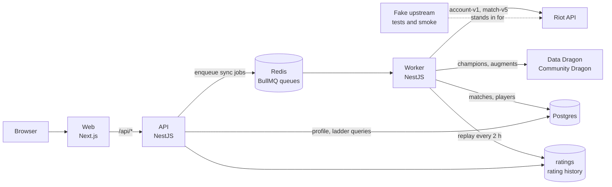

# arena-ranking

A stats tracker and community ladder for the Arena mode of League of Legends, on the Brazil server, built from match history pulled through the Riot API.

**Status: work in progress.** Search, profiles, the rating replay and the ladder are built and run end to end, in tests against recorded Riot data and by hand against the live API on a development key. Nothing is public yet. Riot forbids public use of a development key, so the site waits on Riot's production key, and the deploy hardening for rollback, restore and monitoring is not built.

## What it is

Arena has no official ranked ladder or stats page. The fan-made site that fills the gap does not sync a player's history fully, so a profile can show 13 games for someone who has played hundreds this season, and every rating and win rate built on top inherits the error. It then puts deeper stats behind donation tiers.

I built this for my friends and me, who play Arena on the Brazil server and want the real numbers: how many games, where we place, which champions work, who we play well with, and where we rank. The aim is to be correct, not to have more features.

A search for a Riot ID such as `Name#TAG` starts a sync of that player's whole current-season Arena history, and the profile fills in within seconds. Earlier 2026 seasons follow in the background. Every match stored also records the other players in the lobby, so the ladder grows outward from each search and from an hourly sweep of recently active players. Each lobby format gets its own ladder, so 6 teams of 3 and 8 teams of 2 never mix, sorted by a Plackett-Luce skill rating.

## What works today

- **Search and profile.** A Riot ID resolves at Riot once, then the profile shows games, wins, top-4 rate, average placement and a placement histogram, scoped by format and season. Evidence: `apps/backend/test/sync.e2e.test.ts`, `profile.e2e.test.ts`, `apps/web/smoke/profile.spec.ts`.
- **Breakdowns.** Per-champion stats, teammates with shared results, and a paged match list, newest first. Evidence: `apps/backend/test/breakdowns.e2e.test.ts`, `apps/web/smoke/breakdowns.spec.ts`.
- **Backfill and freshness.** Earlier 2026 seasons fill in at the lowest priority. An hourly sweep re-syncs anyone with a match in the last 168 hours, and "Update now" queues a sync with a 2 minute cooldown per profile. Evidence: `backfill-sweep.e2e.test.ts`, `refresh.e2e.test.ts`, `apps/web/smoke/refresh.spec.ts`.
- **Rating and ladder.** A replay every two hours rates every match in each format and scope. The ladder lists players with at least 10 games, pages by cursor and finds a Riot ID's rank. A profile shows its rating history as a chart. Evidence: `apps/backend/src/modules/rating/rating-replay.test.ts`, `ladder.e2e.test.ts`, `apps/web/smoke/ladder.spec.ts`.
- **Link previews.** A pasted profile or ladder link carries OpenGraph and Twitter tags with the player's numbers. Evidence: `pnpm smoke:og`.
- **Riot key handling.** Every Riot request goes through one rate-limited queue. A 429 holds the queue for its Retry-After, and a rejected key pauses it until a probe with the key file's new contents succeeds. Evidence: `rate-limit.e2e.test.ts`, `ops.e2e.test.ts`.
- **Deploy kit.** arm64 images, a production compose stack with memory limits, nightly backups to Cloudflare R2 and a restore path. Evidence: `pnpm stack:smoke`, `pnpm stack:restore-test`.

On 2026-11-12, `pnpm test` passed 230 tests in 26 suites and `pnpm smoke` passed 19 browser specs, both against the anonymised fixtures.

### Next

From the deploy plan, in the terms of [GLOSSARY.md](GLOSSARY.md):

1. Rollback to an explicit release, and a restore that checks the dump first and can itself be undone.
2. A guard, a scheduled check that reports the last backup, service health and whether Riot accepts the key on every run.
3. One command for the daily development-key rotation.
4. Get the production key from Riot, then remove the shared password. That is the whole step from Gated to Open.

## Run it

| Fact | Value |
| --- | --- |
| Runtime | Node.js 22.12 or later (`.nvmrc`: 22) |
| Package manager | pnpm 11.5.2 (`packageManager` in `package.json`) |
| Operating system | Developed on macOS; anything that runs Docker and a POSIX shell. Release images build for `linux/arm64` |
| External services | Postgres 17 and Redis 7, both from `compose.dev.yaml` through Docker |
| Paid keys | No. Tests and smoke runs use the fake upstream. Live data needs a free Riot development key |
| Ports | 54329 (Postgres), 63799 (Redis), 3001 (API); `pnpm smoke` picks free ports for the rest |
| Time to first run | Not measured |

The install, database, migration and fixture steps, `pnpm test` and `pnpm smoke` were run on 2026-11-12. Not run here: the steps that start the app against live Riot data.

1. Install dependencies.

   ```sh
   pnpm install
   ```

   Expect: pnpm installs the workspace (`apps/backend`, `apps/web`, `apps/fake-upstream`, `packages/shared`) with no errors.

2. Start Postgres and Redis.

   ```sh
   pnpm db:up
   ```

   Expect: Docker Compose reports both containers healthy; a second run leaves them as they are.

3. Apply the migrations.

   ```sh
   pnpm migrate
   ```

   Expect: the migrations in `apps/backend/migrations/` are applied; a second run prints `migrate: up to date`.

4. Check the committed Riot fixtures.

   ```sh
   pnpm fixtures:check
   ```

   Expect: `fixtures:check: ok; Player0001#ANON (74 current-season recorded of 304 listed), Player0002#ANON (60 current-season recorded of 96 listed); 33 shared; 10 derived`.

5. Run the browser smoke. It starts the fake upstream, API, worker and web app on free ports, then runs Playwright.

   ```sh
   pnpm smoke
   ```

   Expect: Playwright ends with `19 passed`.

6. Run it against the live Riot API, in three terminals.

   ```sh
   export RIOT_API_KEY=RGAPI-your-development-key
   pnpm --filter @arena/backend build
   pnpm --filter @arena/backend start:api
   ```

   ```sh
   pnpm --filter @arena/backend start:worker
   ```

   ```sh
   pnpm --filter @arena/web dev
   ```

   Expect: `curl localhost:3001/api/health` shows `ops.riotKey` `ok`, and a Riot ID searched on the web app's home page opens its profile with a sync banner that clears once the history is in.

### Check it works

```sh
pnpm typecheck && pnpm lint && pnpm test
```

Expect: Jest ends with `Test Suites: 25 passed, 25 total`, as it did when v1 merged. Later commits added tests, so the counts may be higher. Each run creates its own database and Redis key prefix.

### Environment variables

Every variable has a local default. `.env.example` lists all of them.

| Name | Required | What it does | How to get a value |
| --- | --- | --- | --- |
| `RIOT_API_KEY` | For live data | The Riot key, used while `RIOT_KEY_FILE` is unset or empty | A development key from the Riot developer portal; it expires daily |
| `RIOT_KEY_FILE` | No | Path of a file holding the key, re-read on every request | Any file you write the key into |
| `DATABASE_URL` | No | Postgres connection | Defaults to the `pnpm db:up` container |
| `REDIS_URL` | No | Redis connection | Defaults to the `pnpm db:up` container |
| `ARENA_QUEUE_IDS` | No | Queue ids every Arena listing runs once per | Default `1700,1710,1740,1750`; `pnpm riot:queues Name#TAG` finds new ones |
| `RIOT_RATE_PER_SECOND`, `RIOT_RATE_PER_TWO_MINUTES` | No | The key's two rate windows | Defaults 20 and 100, a development key's limits |
| `LADDER_MIN_GAMES` | No | Games before a player is ranked | Default 10 |
| `DASHBOARD_USER`, `DASHBOARD_PASS` | No | Basic auth for the queue dashboard at `/api/ops/queues`; unset, it is not mounted | Choose them |
| `TRUSTED_PROXIES` | No | Peers whose `X-Forwarded-For` names the client for the refresh limit | Default `loopback` |
| `API_INTERNAL_URL` | No | Where the web app forwards `/api/*` | Default `http://localhost:3001` |
| `FIXTURE_RIOT_ID` | For `pnpm record-fixtures` | Whose history the recorder records | Any Riot ID on the Brazil server |

### If it fails

- **A profile shows fewer games than the game client.** Riot may have started using an Arena queue id it does not publish. Run `pnpm riot:queues Name#TAG`, then add the id it reports to `ARENA_QUEUE_IDS` ([docs/riot-fixtures.md](docs/riot-fixtures.md)).
- **Health shows the Riot key as rejected.** Development keys expire daily. Write the new key into the key file in place. The worker's probe resumes the queue within a minute, with no restart ([docs/ops.md](docs/ops.md)).
- **`pnpm fixtures:check` exits 1.** It lists each missing or inconsistent fixture. `pnpm fixtures:derive` rewrites the derived ones ([docs/riot-fixtures.md](docs/riot-fixtures.md)).

For agents: the repository has no `CLAUDE.md` or `AGENTS.md`. The working rules, meaning the layout and where a feature plugs in, are in [docs/workspace.md](docs/workspace.md), and each feature documents itself in its own file under `docs/`.

## How it's built



| Path | What lives there |
| --- | --- |
| `apps/backend/src/modules/` | Riot client, sync, match store, formats, seasons, rating, ladder, profile, static data, ops |
| `apps/backend/migrations/` | Plain SQL migrations, applied in name order by `pnpm migrate` |
| `apps/backend/test/` | End-to-end tests against Postgres, Redis and the fake upstream |
| `apps/web/` | Next.js pages: home, `/br/<name>-<tag>` profile, `/ladder`, `/about`; Playwright specs in `smoke/` |
| `apps/fake-upstream/` | One HTTP server standing in for every upstream host, and the anonymised fixtures it serves |
| `packages/shared/` | API response types shared by backend and web |
| `scripts/` | Fixture recorder, anonymiser and check, `riot:queues`, smoke launchers |
| `deploy/stack/` | Production compose file, build, ship, deploy, rollback, backup and restore scripts, Caddy block |
| `docs/` | One file per feature, the deploy runbook and the decision records in `docs/adr/` |

## Why it's built this way

**The lobby shape names the format, never the queue id.**
Riot's published queue list names only 1700 and 1710 for Arena. The 2026 matches came under 1740 and 1750, which it does not publish, and 1700 carried 8x2 lobbies while 1740 and 1750 carried 6x3. So the detector groups participants by subteam, uneven teams count as irregular and get no ladder, and the queue ids live in a variable that `pnpm riot:queues` helps extend. The cost is one listing per queue id, four per sync. ([formats and seasons](docs/formats-and-seasons.md), [Arena queue ids](docs/riot-fixtures.md#arena-queue-ids))

**Ratings are replayed from the whole match table every two hours.**
A match reaches the database from whichever player's sync finds it first, and a rating must depend only on the matches played, not on the order the site discovered them. The replay sorts by end time, then match id, and writes a new run that readers see only once it is complete. The database keeps the latest two complete runs. The cost is a ladder up to two hours behind, which the page says with its last and next replay times. ([rating and ladder](docs/rating-and-ladder.md))

**One queue carries every Riot request, and a tenth of each rate window is kept for the search lookup.**
The development key allows 20 requests a second and 100 every two minutes, and a backfill alone can use all of it. A waiting human goes first, then the sweep, then the backfill. The Riot ID lookup a search waits on also gets 2 of the 20 and 10 of the 100 that sync jobs cannot take. A lookup that still finds no slot answers 503 after 10 seconds. ([ops](docs/ops.md), [sync and profile](docs/sync-and-profile.md))

**The site stays behind one shared password until Riot grants a production key.**
Riot's terms forbid public use of a development key, and a revoked key would stop the crawl. I rejected opening on the development key for that risk. I also rejected waiting to deploy, which loses weeks of crawl and leaves Riot's reviewer nothing to look at. Removing the Caddy `basic_auth` block is the only step to Open. ([ADR 0001](docs/adr/0001-gated-until-production-key.md))

**Releases are built on a laptop and shipped over SSH, with no registry and no CI.**
The server is a 2 vCPU free-tier machine shared with other services, and the project has one operator. Building on the box would put a Node toolchain beside the other services' memory, and a registry would add a credential and a pull path to secure for a few images a week. The cost is a deploy that needs the operator's machine, to revisit with a second operator. ([ADR 0003](docs/adr/0003-ship-over-ssh-no-registry.md))

**NestJS stays on 11.**
NestJS 12 ships only as ESM, and the test runner is Jest. SWC compiles the backend and runs it under Jest with decorator metadata kept. `tsc` only typechecks. ([workspace](docs/workspace.md))

**Tests talk to a fake Riot that serves anonymised recordings and builds its own listings.**
The fake serves each recorded response at its path and answers 404 naming the path for anything not recorded, never an empty 200. It builds match-id listings from the matches it holds instead of replaying recorded ones, so time-windowed and incremental syncs can be tested. The recordings held about 1,750 real players. The recorder now writes to a directory git ignores, and `scripts/anonymise-fixtures.ts` replaces every identifier with a synthetic one before anything is committed. Dropping the unread participant blocks cut the set from 30 MB to 13 MB. ([fixtures](docs/riot-fixtures.md#fixtures))

## How it was made

The work ran from one written spec, split into tickets. Claude Code built each ticket in its own branch, and a ticket landed only when its checks passed. I reviewed every pull request before it merged. Decisions are recorded in [docs/adr](docs/adr).

## Credits and licence

arena-ranking isn't endorsed by Riot Games and doesn't reflect the views or opinions of Riot Games or anyone officially involved in producing or managing Riot Games properties. Riot Games, and all associated properties are trademarks or registered trademarks of Riot Games, Inc.

- No Riot art or icons are in the repository. The web app loads champion icons from Riot's public Data Dragon host at runtime.
- `apps/fake-upstream/fixtures-anon/` holds match data recorded from the Riot API with every player identifier replaced, Data Dragon's champion data for patch 16.20.1, and Community Dragon's Arena augment list cut to six fields.
- Libraries, each under its own licence: NestJS, BullMQ, bull-board, Drizzle ORM, node-postgres, ioredis, pino, openskill, Next.js, React, Recharts, Tailwind CSS, Jest and Playwright.

MIT licence, `Copyright (c) 2026 Kevin Shibuya`. See [LICENSE](LICENSE).
